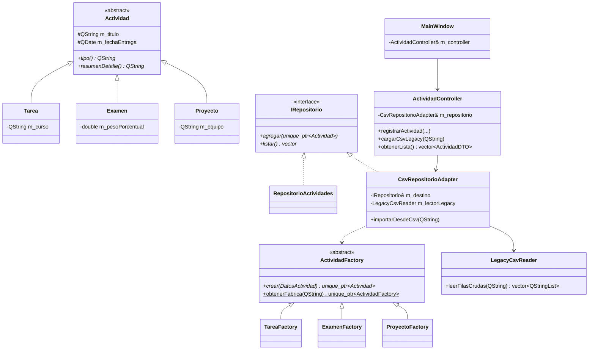

$utf8NoBom = New-Object System.Text.UTF8Encoding $false

$readmeCompleto = @'
# Laboratorio N.° 09: Aplicación de Patrones de Diseño y Arquitectura MVC con Qt 6

**Universidad Nacional de San Agustín de Arequipa (UNSA)**  
**Escuela Profesional de Ingeniería de Sistemas — Tecnología de Objetos (Tercera Unidad)**

Sistema de seguimiento académico desarrollado en **C++20** y **Qt 6.12.0 Widgets**, diseñado para resolver el acoplamiento entre interfaz gráfica, creación de objetos y lectura de datos heredados mediante **MVC**, **Factory Method** y **Adapter**.

---

## 1. Problema Resuelto y Objetivos

La versión inicial acoplaba la interfaz gráfica (`MainWindow`) con la instanciación directa de actividades (`Tarea`, `Examen`, `Proyecto`) y la lectura manual de archivos CSV heredados. La refactorización logra:

1. **Separar responsabilidades en MVC:** Aislar las reglas de negocio en el Modelo, la presentación en la Vista y la coordinación en el Controlador.
2. **Desacoplar la creación (Factory Method):** Centralizar la validación de invariantes antes de instanciar cada tipo de actividad.
3. **Integrar formato heredado (Adapter):** Traducir registros CSV antiguos (`;`, códigos `TAR`/`EXA`/`PRO`) hacia la interfaz `IRepositorio` sin modificar el lector legado.
4. **Probar sin GUI (`Qt Test`):** Validar Modelo, Patrones y Controlador de forma desatendida mediante `QSignalSpy`.

---

## 2. Arquitectura MVC y Diagrama de Clases



### Estructura del Repositorio (`lab09/`)

```text
lab09/
├── CMakeLists.txt                  # Compilación C++20: lab09_core, lab09_app y lab09_tests
├── README.md                       # Documentación técnica del proyecto
├── data/
│   └── legacy_actividades.csv      # Dataset heredado delimitado por ';'
├── src/
│   ├── main.cpp                    # Composition Root (inyección de dependencias)
│   ├── model/                      # Modelo puro (solo QtCore + STL)
│   │   ├── Actividad.h / .cpp      # Entidades del dominio
│   │   ├── IRepositorio.h          # Contrato de persistencia en memoria
│   │   └── RepositorioActividades.h / .cpp
│   ├── patterns/                   # Patrones creacional y estructural
│   │   ├── ActividadFactory.h / .cpp      # Factory Method + validaciones
│   │   ├── LegacyCsvReader.h / .cpp       # Adaptee (formato antiguo)
│   │   └── CsvRepositorioAdapter.h / .cpp # Adapter hacia IRepositorio
│   ├── controller/                 # Coordinación y DTOs de solo lectura
│   │   └── ActividadController.h / .cpp
│   └── view/                       # Interfaz gráfica Qt Widgets
│       └── MainWindow.h / .cpp
└── tests/
    └── TestMvcPatrones.cpp         # Suite de pruebas unitarias sin GUI
```

---

## 3. Explicación de Implementación por Capas

### A. Patrón Creacional: Factory Method (`src/patterns/ActividadFactory.cpp`)
Valida las reglas específicas de cada subclase antes de construir el objeto, evitando que el Controlador o la Vista conozcan constructores concretos:

```cpp
std::unique_ptr<Actividad> ExamenFactory::crear(const DatosActividad& datos) const {
    validarComun(datos);
    bool ok = false;
    double peso = datos.extra.trimmed().toDouble(&ok);
    if (!ok || peso <= 0.0 || peso > 100.0) {
        throw std::invalid_argument("El examen requiere un peso numerico valido entre 1 y 100.");
    }
    return std::make_unique<Examen>(datos.titulo.trimmed(), datos.fechaEntrega, peso);
}
```

### B. Patrón Estructural: Adapter (`src/patterns/CsvRepositorioAdapter.cpp`)
Envuelve a `LegacyCsvReader` (inmodificable) e implementa `IRepositorio`, traduciendo códigos heredados (`TAR`, `EXA`, `PRO`) y delegando la creación a `ActividadFactory`:

```cpp
void CsvRepositorioAdapter::importarDesdeCsv(const QString& rutaArchivo) {
    const auto filas = m_lectorLegacy.leerFilasCrudas(rutaArchivo);
    for (const auto& cols : filas) {
        if (cols.size() < 4) throw std::runtime_error("Registro CSV incompleto.");
        DatosActividad datos{
            .tipo = traducirCodigoTipo(cols.value(0)),
            .titulo = cols.value(1).trimmed(),
            .fechaEntrega = QDate::fromString(cols.value(2).trimmed(), Qt::ISODate),
            .extra = cols.value(3).trimmed()
        };
        auto fabrica = ActividadFactory::obtenerFabrica(datos.tipo);
        m_destino.agregar(fabrica->crear(datos));
    }
}
```

### C. Controlador y Protección del Modelo (`src/controller/ActividadController.cpp`)
Impide que la Vista modifique las colecciones internas exponiendo únicamente `ActividadDTO` (datos planos de lectura) y notificando cambios mediante *Signals & Slots*:

```cpp
void ActividadController::registrarActividad(const QString& tipo, const QString& titulo,
                                             const QDate& fecha, const QString& extra) {
    try {
        DatosActividad datos{tipo, titulo, fecha, extra};
        auto fabrica = ActividadFactory::obtenerFabrica(tipo);
        m_repositorio.agregar(fabrica->crear(datos));
        emit listaActualizada();
    } catch (const std::exception& ex) {
        emit operacionFallida(QString::fromUtf8(ex.what()));
    }
}
```

---

## 4. Cuadro de Pruebas Unitarias (`Qt Test` sin GUI)

Las pruebas enlazan únicamente contra `lab09_core` (sin `QtWidgets`), verificando comportamiento y emisión de señales con `QSignalSpy`:

| Caso de Prueba | Patrón / Capa Evaluada | Escenario de Entrada | Resultado Verificado | Estado |
| :--- | :--- | :--- | :--- | :---: |
| `testFactoryMethodValidoEInvalido` | Factory Method (`ExamenFactory`) | Peso válido `25.0` vs. peso inválido `-10` | Instancia `Examen` con detalle `"Peso: 25.0%"`; lanza `std::invalid_argument` en caso negativo | **PASS** |
| `testAdapterImportaCsvLegacy` | Adapter (`CsvRepositorioAdapter`) | Archivo temporal con cabecera y filas `TAR` y `PRO` | Traduce códigos heredados e inserta 2 entidades tipadas en `RepositorioActividades` | **PASS** |
| `testControllerEmiteSenalesSinGui` | Controlador (`ActividadController`) | Registro válido `"Guia Lab 09"` vs. título vacío `"   "` | `QSignalSpy` registra 1 señal `listaActualizada` y 1 señal `operacionFallida` | **PASS** |

---

## 5. Comparación Antes vs. Después de la Refactorización

| Métrica de Arquitectura | Antes (GUI Acoplada) | Después (MVC + Patrones) | Mejora Obtenida |
| :--- | :---: | :---: | :--- |
| Inclusiones (`#include`) de clases del Modelo en `MainWindow` | 4 (`Tarea`, `Examen`, `Proyecto`, CSV) | **0** (solo `ActividadController.h`) | Desacoplamiento total de la Vista |
| Archivos afectados al añadir un nuevo tipo (ej. `Laboratorio`) | 4 archivos modificados | **2 archivos** (subclase + fábrica) | Cumplimiento de Open/Closed (OCP) |
| Cobertura de pruebas automatizadas sin interfaz gráfica | 0% (dependía de `QWidget`) | **100%** de reglas de negocio y flujo | Ejecución rápida en consola (`ctest`) |

---

## 6. Síntesis de Preguntas de Análisis

* **¿Qué problema concreto justifica Factory Method?** Elimina la duplicación de validaciones e instanciación polimórfica dispersa entre el formulario manual y la importación CSV.
* **¿Cuándo Adapter es preferible a modificar el componente heredado?** Cuando `LegacyCsvReader` pertenece a un módulo externo, tiene pruebas legadas estables o es usado por otros sistemas que dependen de su formato original.
* **¿Qué dependencias no debe tener el Modelo en MVC?** Nunca debe incluir encabezados de `QtWidgets`, referencias a controles visuales (`QTableWidget`, `QMessageBox`) ni punteros hacia la Vista o el Controlador.
* **¿Qué costo introduce cada patrón y cómo se verificó su beneficio?** Introduce mayor cantidad de clases e indirección; el beneficio se verificó aislando `lab09_core` en CMake y ejecutando `lab09_tests` sin levantar GUI.

---

## 7. Compilación y Ejecución

### Requisitos del entorno
* **Qt:** 6.12.0 (`Core`, `Widgets`, `Test`)
* **Compilador:** MinGW GCC 13.1.0 con soporte **C++20**
* **Herramienta de construcción:** CMake 3.16+

### Comandos (compilación fuera del árbol en `build/`)
```bash
# 1. Configurar proyecto
